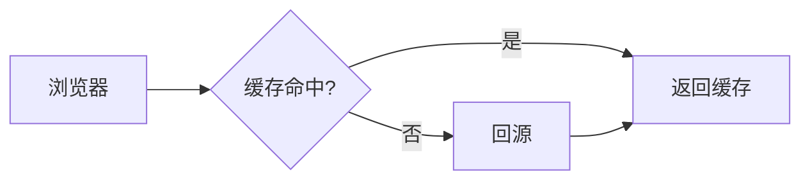
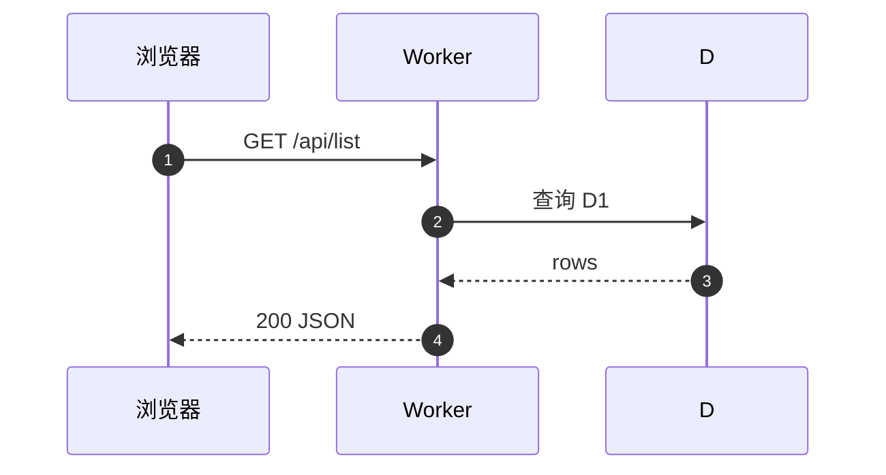
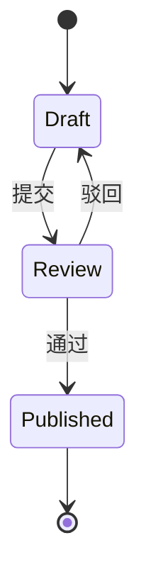
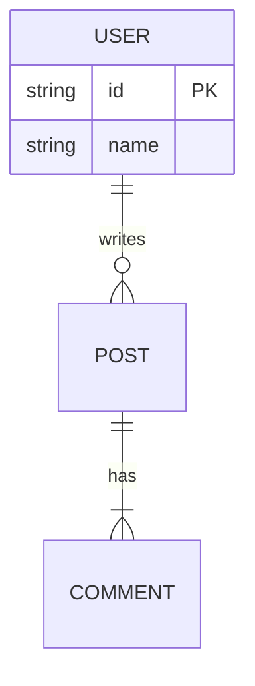
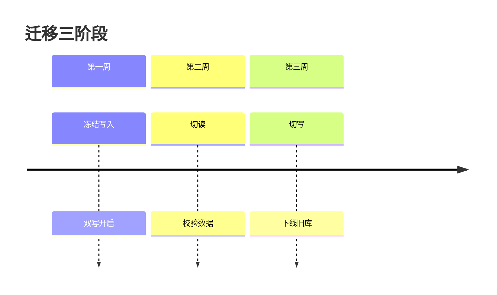
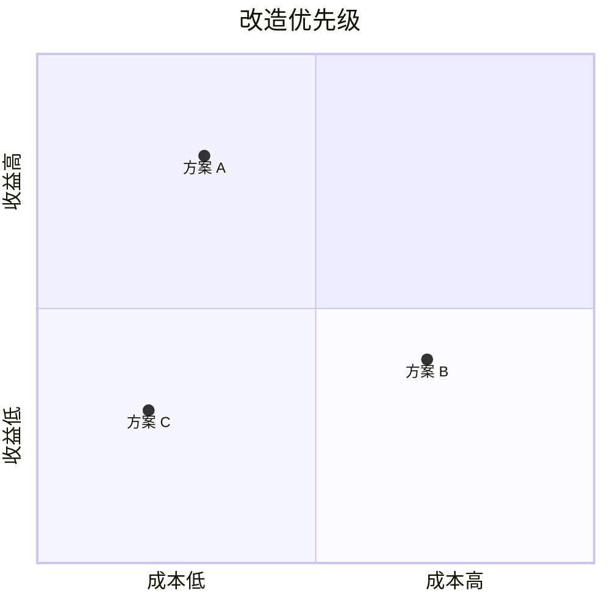

# Diagrams with Pele

Structured diagrams come from [Pele](https://pele.run): Mermaid syntax rendered to themeable SVG at build time. The page gains no JavaScript, works offline, and each diagram costs 2–10 KB. The template's `.pele` CSS maps the SVG to the report palette automatically; do not re-theme it per page.

Contents:

- [The workflow](#the-workflow)
- [Pick the diagram by content](#pick-the-diagram-by-content)
- [Writing a block](#writing-a-block)
- [Keeping diagrams readable](#keeping-diagrams-readable)
- [Troubleshooting](#troubleshooting)

## The workflow

1. In `index.html`, write a `<pre class="mermaid">` block where the diagram belongs (see [Writing a block](#writing-a-block)).
2. Render, before Step 6:

   ```bash
   bash <skill-dir>/scripts/render-diagrams.sh "$dir/index.html"
   ```

3. Exit 0 prints `rendered N diagram(s)`; the block becomes `<figure class="diagram">…svg…<figcaption>…</figcaption></figure>`. Exit 4 lists each failing diagram with line and column; fix the Mermaid source and re-run. The file is written only when every diagram renders.
4. Editing a rendered diagram later means restoring its `<pre class="mermaid">` block by hand, or keeping the source in the page as a comment. For a page still being drafted, write all blocks first, render once, and verify.

A plain report needs no server and no network to show the SVG. `--check` validates every block without writing the file.

## Pick the diagram by content

Pele supports every Mermaid 12.1 type. These are the ones a report normally needs; pick the first match.

| The content is…                                        | Diagram type | First line of the source |
| ------------------------------------------------------ | ------------ | ------------------------ |
| A decision path, request flow, or build pipeline       | Flowchart    | `flowchart TD`           |
| Who calls whom, in what order (APIs, services, agents) | Sequence     | `sequenceDiagram`        |
| Lifecycle stages and what moves between them           | State        | `stateDiagram-v2`        |
| Tables and their relations (a data model)              | ER           | `erDiagram`              |
| A file tree or directory layout                        | Tree view    | `treeView-beta`          |
| A hierarchy of ideas or a taxonomy                     | Mindmap      | `mindmap`                |
| Milestones in order                                    | Timeline     | `timeline`               |
| Tasks over dates, with durations and dependencies      | Gantt        | `gantt`                  |
| A deployment or network topology                       | Architecture | `architecture-beta`      |
| Options positioned on two axes                         | Quadrant     | `quadrantChart`          |
| Shares of a whole                                      | Pie          | `pie`                    |
| How volume flows between stages                        | Sankey       | `sankey`                 |
| Causes of one failure, grouped                         | Ishikawa     | `ishikawa-beta`          |
| Branch and merge history                               | Git graph    | `gitGraph`               |

Snippets for the most common types (keep labels in the page language):














A flowchart still fits many of these rows. When unsure between a flowchart and a specialized type, use the specialized one: it states the relationship instead of making the reader read arrows.

## Writing a block

```html
<pre class="mermaid" data-caption="请求路径">
flowchart LR
  A[浏览器] --> B[缓存]
</pre>
```

- `data-caption` adds the figcaption. Give every diagram one; state the point, not the type (`缓存命中时不回源`, not `流程图`).
- `data-wide` on the same `<pre>` lets the figure grow past the reading column, up to 1080 px; the panel still hugs the diagram's natural width. Use it only when the rendered diagram is genuinely wider than the column (~700 px) — a small diagram gains nothing from it.
- The pre holds HTML text: write `&lt;` for `<` (so Mermaid's `<br/>` becomes `&lt;br/>`) and `&amp;` for `&`. A bare `>` needs no escape.
- Indentation inside the block is fine; leading and trailing blank lines are trimmed.
- Keep entity and participant IDs ASCII (`USER`, `participant B as 浏览器`); the visible alias after `as` may be any language.
- The script renders at `maxWidth: 1040`, so a wide diagram adapts instead of shrinking text below 14 px.

## Keeping diagrams readable

- One idea per diagram. Past about 15 nodes or 3 levels of subgraphs, split it or move the detail to a table.
- Prefer `flowchart TD` for the narrow column; `LR` suits short chains and pipelines.
- Labels stay short: a node label is a noun phrase, an edge label a verb. Sentences belong in prose.
- Leave the theme alone. Use `classDef` only to mark a real status with the template's colors (for example `classDef risk fill:#99392f,color:#fffdf8`); fixed colors do not adapt, so never restyle the whole diagram.
- Do not paste a diagram the reader must zoom into. If it needs `.wide` and small text, it is two diagrams.
- Count diagrams toward the size budget: 2–10 KB each, so a page of six still fits well under 150 KB. Keep the count to what carries a finding.

## Troubleshooting

| Symptom                                           | Action                                                                                                                                        |
| ------------------------------------------------- | --------------------------------------------------------------------------------------------------------------------------------------------- |
| Exit 4, `unsupported-diagram`                     | The type needs the full build; `render-diagrams.sh` uses it, so this means the first line is misspelled (`stateDiagram-v2`, `treeView-beta`). |
| Exit 3, npm install failed                        | No network. Write the diagram as hand-drawn inline SVG per components.md instead, or retry later.                                             |
| Exit 2, node missing                              | Node ≥ 20 is required; say so in the hand-over and fall back to hand-drawn SVG.                                                               |
| Labels overlap or clip                            | Long CJK labels can outgrow the estimated width. Shorten the label, or add a line break with `&lt;br/>`.                                      |
| Diagram renders but looks wrong in the screenshot | Check the figure sits inside `<main class="page">`; the `.pele` variables come from the template.                                             |
| `no <pre class="mermaid"> blocks found`           | The blocks are already rendered (search for `figure class="diagram"`), or the class attribute is not exactly `class="mermaid"`.               |
