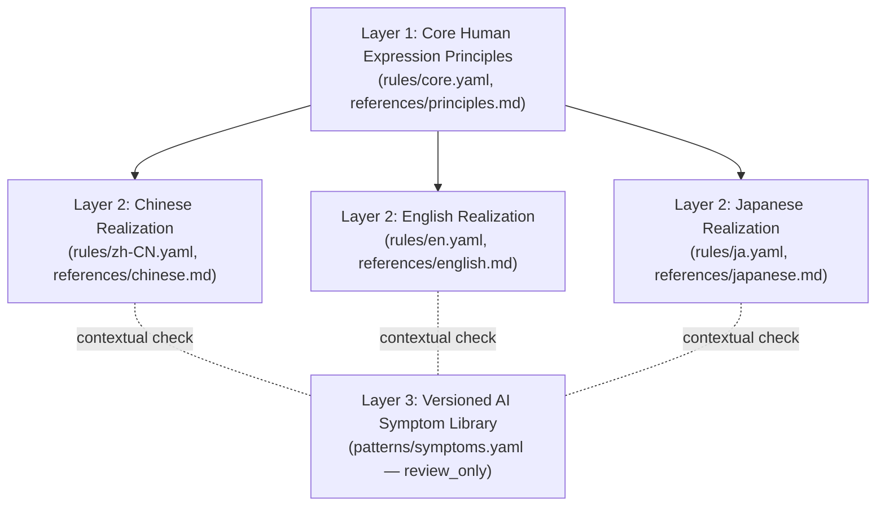

# Natural Writing Skill (`natural-writing`)

A cross-model, cross-language (`zh-CN`, `en`, `ja`) Agent Skill for generating, reviewing, diagnosing, and rewriting natural human prose.

## Core Design Philosophy: Three-Layer Decoupling

Most "de-AI" prompts fail over time because they hardcode a flat blacklist of phrases favored by a single model generation. When model weights or post-training datasets shift, static blacklists become obsolete—or worse, cause collateral damage by banning legitimate rhetorical structures (`not X, but Y`) and pushing models into forced colloquial slang.

`natural-writing` solves this through a three-layer architecture:



1. **Layer 1: Core Human Expression Principles (`layer: core`)**
   Timeless communicative principles established long before LLMs (Orwell 1946, Strunk & White 1959, Zinsser 1976, Williams 1981, Pinker 2014, Gowers 1954, Grice 1975, Brown & Levinson 1987, Lakoff & Johnson 1980), reinforced by modern developer-documentation standards (Vercel Writing Guidelines 2026). These principles hold across languages and models.
2. **Layer 2: Language & Context Realization (`layer: language`)**
   Language-specific realizations grounded in each language's own grammar, collocation system, politeness calculus, and stylistic tradition:
   - **Chinese (`zh-CN`)**: Lv Shuxiang & Zhu Dexi (1952), Wang Li (1943), Zhu Dexi (1982), Ye Shengtao (1934), Zhu Guangqian (1946), Yu Kwang-chung (1987).
   - **English (`en`)**: Orwell (1946), Strunk & White (1959), Zinsser (1976), Williams (1981), Pinker (2014), Gowers (1954), Fowler (1926), US Federal Plain Language Guidelines (2010), Vercel Writing Guidelines (2026).
   - **Japanese (`ja`)**: Tanizaki (1934), Iwabuchi (1960), Honda Katsuichi (1976), Kinoshita Koreo (1981), Agency for Cultural Affairs _Keigo no Shishin_ (2007) and _Kouyoubun Sakusei no Kangaekata_ (2022), and _Yasashii Nihongo_ research.
3. **Layer 3: Versioned AI Symptom Library (`layer: symptom`)**
   An independently versioned catalog of model-specific surface habits (`patterns/symptoms.yaml`). Every symptom entry enforces `action_on_match: review_only` and links to the Layer 1/Layer 2 rules that govern when the pattern is a flaw and when it is a valid choice.

## Directory Layout

```text
skills/natural-writing/
├── SKILL.md                  # Lean executable agent entrypoint (<500 lines)
├── README.md                 # Architecture, schema, and maintenance documentation
├── references/
│   ├── foundations.md        # Deep study of Orwell (1946) and cross-linguistic writing theory
│   ├── sources.md            # Traceable bibliography with URLs, scope, and limitations
│   ├── principles.md         # Layer 1 core human expression principles
│   ├── pragmatics.md         # Pragmatic anomaly analysis (Cases A, B, C, D)
│   ├── chinese.md            # Layer 2 Chinese (zh-CN) realization guide
│   ├── english.md            # Layer 2 English (en) realization guide
│   └── japanese.md           # Layer 2 Japanese (ja) realization guide
├── rules/
│   ├── core.yaml             # Layer 1 structured rules (10 core principles)
│   ├── zh-CN.yaml            # Layer 2 Chinese rules (9 rules linked to core.yaml)
│   ├── en.yaml               # Layer 2 English rules (8 rules linked to core.yaml)
│   └── ja.yaml               # Layer 2 Japanese rules (8 rules linked to core.yaml)
├── patterns/
│   ├── symptoms.yaml         # Layer 3 versioned AI symptoms (review_only lifecycle)
│   └── schema.json           # JSON Schema (Draft 2020-12) for rules, symptoms, examples, evals
├── examples/
│   ├── zh-CN.jsonl           # Annotated Chinese before/after/keep examples across genres
│   ├── en.jsonl              # Annotated English before/after/keep examples across genres
│   └── ja.jsonl              # Annotated Japanese before/after/keep examples across genres
├── evals/
│   ├── cases.jsonl           # Multi-lingual evaluation test suite with edge cases
│   ├── rubric.md             # 8-dimension evaluation rubric and grading protocol
│   └── ablation.md           # 4-condition ablation experiment design and empirical results
└── scripts/
    └── validate.py           # Deterministic validator, contextual scanner, and fact-diff tool
```

## Validation & Usage Commands

Run the bundled validation script from the repository root:

```bash
# 1. Validate all YAML rules, symptom lifecycle entries, JSONL datasets, cross-references, and Markdown links
uv run skills/natural-writing/scripts/validate.py

# 2. Scan a draft file for contextual review candidates (never auto-fails)
uv run skills/natural-writing/scripts/validate.py --mode scan --file path/to/draft.md

# 3. Verify zero factual/numeric/terminology drift between original and rewritten text
uv run skills/natural-writing/scripts/validate.py --mode fact-check --original orig.md --rewritten revised.md
```

## Symptom Lifecycle Maintenance

To add, update, or deprecate an AI expression symptom without touching core or language rules:

1. Edit `patterns/symptoms.yaml`.
2. Set `status` to `active` (widespread across current models), `monitoring` (emerging or genre-restricted), or `deprecated` (resolved in newer model families; include `deprecation_note`).
3. Keep `action_on_match: review_only` and link at least one rule ID from `rules/core.yaml` or `rules/{zh-CN,en,ja}.yaml` in `linked_rules`.
4. Provide at least one `verdict: rewrite` example and one `verdict: keep` example demonstrating a valid context.
5. Run `uv run skills/natural-writing/scripts/validate.py` to verify schema compliance and referential integrity.
